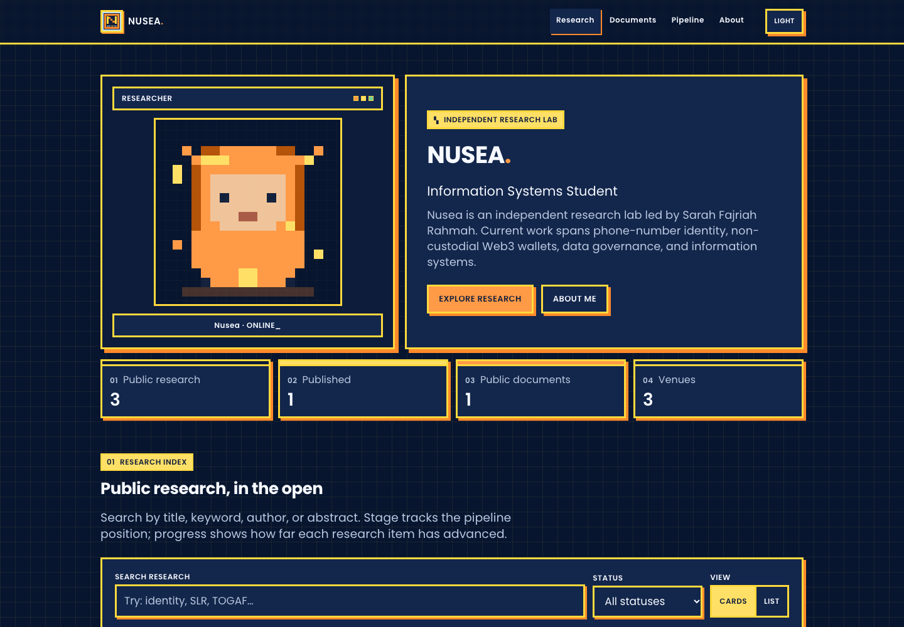
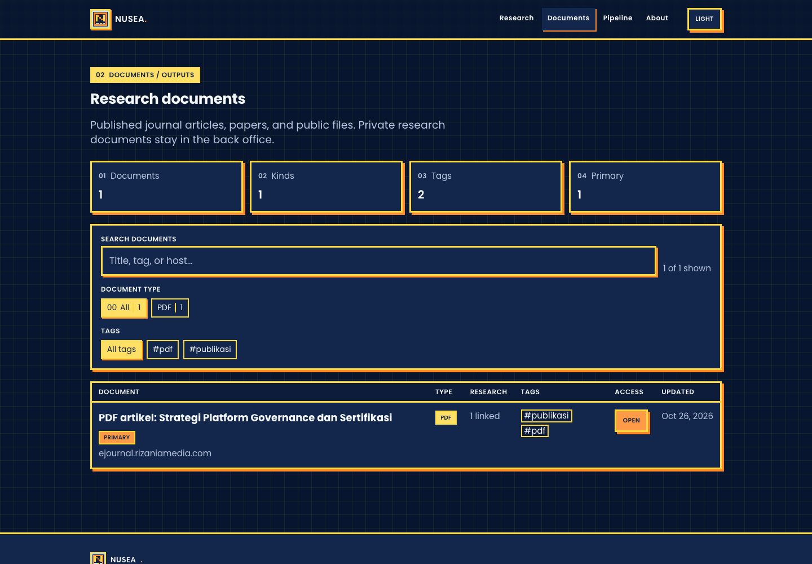
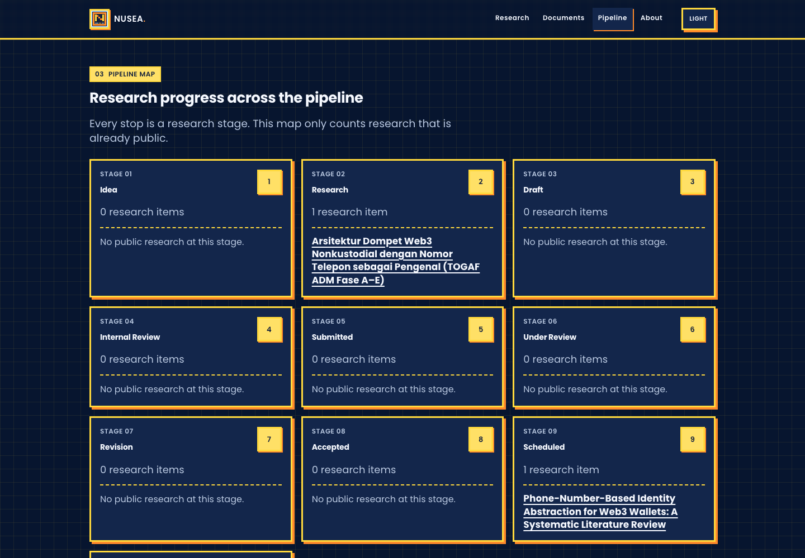
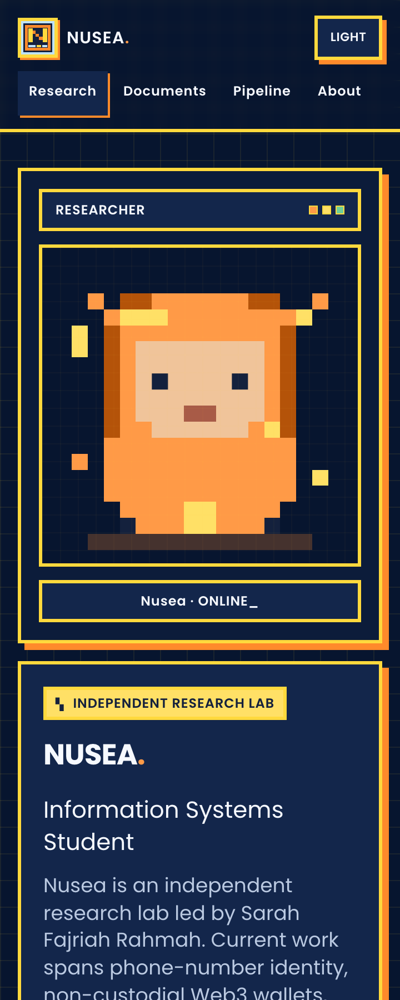
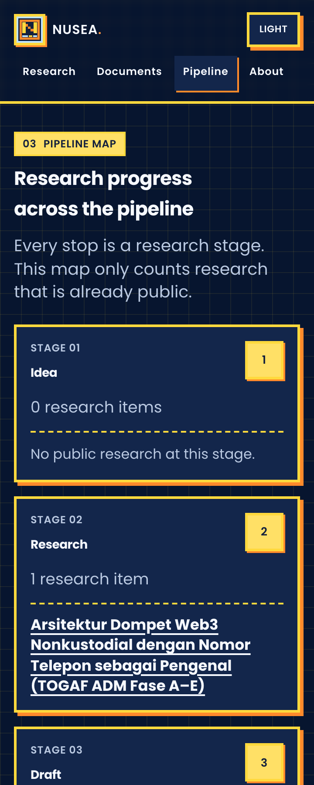

# Nusea

**A pixel-styled research portfolio with a private local back office.**

Nusea publishes research, public outputs, a research map, and a profile — while the owner keeps stage notes, private documents, plans, and day-to-day data on their own machine.



## What it does

- Public research index with search, status, progress, and detail pages.
- `Published`, `Scheduled`, and `Coming soon` states make future work visible without exposing private data.
- Documents page for published journal articles, papers, and public files only.
- A research pipeline map that counts public work only.
- Local admin for research, documents, pipeline, venues, backups, and publishing.
- Allowlist-based public export: private fields never enter the public bundle.
- Leak check fails the production build if private IDs, URLs, or field names appear in `dist/`.

## Screenshots

| Documents | Pipeline |
| --- | --- |
|  |  |

| Mobile home | Mobile pipeline |
| --- | --- |
|  |  |

## Stack

- Vite + React 19 + TypeScript
- Tailwind CSS
- Express + Vite middleware for the local admin
- Zod for data validation
- Vitest for tests
- Netlify for the public deployment

## Requirements

- Node.js 22 or newer
- pnpm 10.34.3 (see `packageManager` in `package.json`)

Use pnpm, not npm.

```bash
pnpm install
```

## Run

Run the public site and admin in separate terminals.

```bash
# Terminal 1 — public site
pnpm dev
# http://127.0.0.1:5173

# Terminal 2 — back office
pnpm admin
# http://127.0.0.1:5174
```

When the admin starts, the terminal prints a random session token. Paste it into the admin gate. The token changes every time the admin server restarts and is never stored in the repo.

Change the admin port if needed:

```bash
ADMIN_PORT=5180 pnpm admin
```

## Design

All text uses Poppins. The pixel feel comes from hard borders, offset shadows, the orange/yellow palette, the grid background, and the pixel avatar — not from a pixel typeface. The public site supports light and dark mode.

## Scripts

| Command | Purpose |
| --- | --- |
| `pnpm dev` | Public site with Vite at `127.0.0.1:5173` |
| `pnpm admin` | Local back office at `127.0.0.1:5174` |
| `pnpm typecheck` | Typecheck the public site and admin |
| `pnpm lint` | ESLint with zero warnings |
| `pnpm test` | Full Vitest suite |
| `pnpm publish:data` | Build `data/public/` from `data/private/` |
| `pnpm check:leak` | Scan `dist/` for private IDs, URLs, and fields |
| `pnpm build` | Typecheck + production build + `check:leak` |
| `pnpm preview` | Preview the production build at `127.0.0.1` |

## Data structure

```text
data/
├── private/          # full source of truth, gitignored, local only
│   ├── profile.json
│   ├── items.json
│   ├── assets.json
│   ├── venues.json
│   ├── sources.json
│   ├── grants.json
│   ├── ideas.json
│   ├── tasks.json
│   └── history.json
├── public/           # generated output, allowlisted fields only, committed
│   ├── profile.json
│   ├── items.json
│   ├── assets.json
│   ├── venues.json
│   ├── grants.json
│   └── ideas.json
└── .backups/         # automatic backups, gitignored
```

`data/private/` is the complete source and is intentionally gitignored. Keep it in a private backup, not in this repository. A fresh clone only needs `data/public/` to build the public site; restore your private files before running `pnpm admin`.

Do not edit `data/public/` by hand; `pnpm publish:data` regenerates it.

## Public boundary and leak checks

The allowlist lives in:

- `shared/public-schemas.ts` — fields allowed to leave the private store
- `shared/public-data.ts` — filters `visibility: "public"` and builds the public bundle

Only records with `visibility: "public"` enter `data/public/`. New fields stay private until explicitly added to the allowlist.

Documents are exported with `researchIds`, not raw `itemIds`. The builder filters those IDs against public research, so a public file can never reveal a private research ID.

`pnpm check:leak` inspects the production build for:

- IDs and URLs belonging to private records
- Private field names such as `notes`, `tasks`, `sources`, `stageNote`, `localPath`, `itemIds`, `howVerified`, `fileOnHand`, and `submitChecklist`
- References to `data/private`

The build must fail on any leak. Do not bypass this check.

Without `data/private/` (for example on Netlify), the check still scans `dist/` for forbidden fields and private references. Locally, with the private store present, it also verifies that no private IDs or URLs leak.

The public site only imports `data/public/` and `shared/`; `src/` must not import `admin/`.

## Public pages

- `/` — overview and featured research
- `/documents` — published journal articles, papers, and public files
- `/pipeline` — research pipeline and activity
- `/about` — profile and contact
- `/research/:slug` — research detail

Only public documents appear in `/documents`. Private links and local paths stay inside the back office. The old `/database` URL redirects here.

## Back office

Available tabs:

- **Dashboard** — public research and the document links attached to it, including private links marked `· private`.
- **Research** — CRUD for every research field, including stage notes and private checklists.
- **Pipeline** — status kanban with history tracking.
- **Documents** — private/public document links and link checks.
- **Venues** — journals, conferences, and grant venues.
- **Profile** — read mode followed by editing.
- **Data** — JSON upload/download, CSV import/export, and backups.
- **Publish** — preview, commit, and push.

Every save is validated with Zod on the server and creates a backup of the previous file. Status changes from forms and the kanban are recorded in `data/private/history.json`.

### Backups and restore

- A backup is created before a file is written.
- The latest 20 backups per file are kept in `data/.backups/`.
- Backups can be downloaded from the **Data** tab.
- Manual restore: download a backup, then upload it through the JSON panel in **Data**. Upload replaces the whole file after validation.

Backups contain private data. Do not share them.

### CSV

The **Data** tab supports CSV import/export for research and grants.

- Use an exported file as the column template.
- Lists (for example `keywords`, `authors`, `team`) are separated with `|`.
- Booleans use `true`/`false`.
- Rows with the same ID update the record; new IDs are appended.
- The server validates the CSV again before saving.
- For research, status changes made through import also create history entries.

## Publishing flow

1. Edit and save data in the admin.
2. Open **Publish** and run **Preview**.
3. Preview runs `publish:data`, the production build, typecheck, and `check:leak`.
4. If preview passes, review the `data/public/` diff.
5. **Commit** stages only `data/public/`.
6. **Push** triggers the Netlify build.

Commit is disabled when preview fails. Push always asks for confirmation.

Equivalent manual commands:

```bash
pnpm publish:data
pnpm build
git add data/public
git commit -m "data: publish YYYY-MM-DD"
git push
```

## Security

The back office is a local tool and must never be exposed to the internet.

- The admin server listens only on `127.0.0.1`.
- Non-loopback connections are rejected with `403`.
- Every `/api` endpoint requires a session token; an invalid token returns `401`.
- The token is random per process and compared in constant time.
- The admin is not built into `dist/`; the public build uses only `index.html` and `src/`.
- `data/private/`, `data/.backups/`, and `assets-private/` are gitignored.
- The admin commit flow stages only `data/public/`, never `data/private/`.

Private data that is not in `data/public/` never reaches the public site. If a document is private, its URL is not listed on any public page — but link-sharing settings on Google Docs, Drive, or Figma still control who can open the raw URL.

## Netlify deploy

`netlify.toml` already configures:

- Build command: `pnpm run build`
- Publish directory: `dist`
- Node.js 22
- SPA redirect to `index.html`

Connect the repo to Netlify. Never deploy the admin server. Netlify builds from the committed `data/public/` files; `data/private/` is not required and is not in the repository.

## Verification

```bash
pnpm typecheck
pnpm lint
pnpm test
pnpm build
```

Tests cover the public allowlist, leak detection, server guard, backup/atomic writes, status transitions and history, and CSV parsing.
